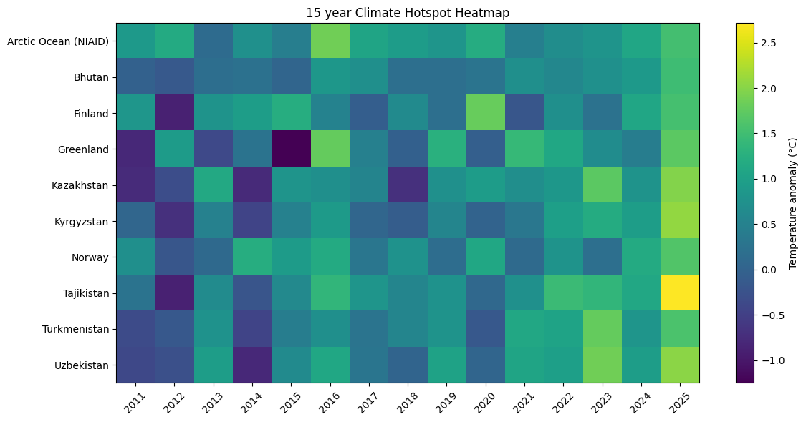

# Climate Change Project

[](https://jupyter.org/)
[](https://www.python.org/)
[](https://pandas.pydata.org/)
[](https://numpy.org/)
[](https://matplotlib.org)
[](https://scikit-learn.org/)  


created by: [aahan-kumar](https://github.com/aahan-kumar) @ github • Oct 2026

This project uses real world temperature anomaly data to look at climate change patterns across different places and years.

Temperature anomaly is an important metric used by scientists and environmental organisations to track global warming and climate change. It is calculated as the difference between an observed temperature and a long term average (baseline) temperature.

The data contains different places and their temperature anomalies from 1940 onwards.

Source: Our World in Data (OWID) - Annual Temperature Anomalies [see here](#data-source)

## Work Done
1. Load the OWID csv dataset using pandas and created a DataFrame 
2. Look at the global temperature anomaly series using the `World` entry already present in the dataset.
3. Find the places with the highest temperature anomalies in 2025 and India's position in the 2025 anomaly ranking.
4. Use KMeans clustering on the 2016-2025 data to group places using recent anomaly, variation and recent linear trend.
5. Analyse India's temperature anomaly data separately using a 5 year rolling average and linear regression. A simple trend extrapolation was then made for 2026-2050.
6. Create a heatmap for the selected climate hotspots from 2011 to 2025.

## Dataset
The dataset used in this project contains:
- 18,318 records
- Years 1940 to 2025
- Place
- Year
- Temperature anomaly (deg C)

The project uses the `World` entry present in the dataset for the global series.

## Methods used
- Python
- pandas
- NumPy
- Matplotlib
- scikit-learn
- Linear Regression
- KMeans Clustering
- StandardScaler
- Mean Absolute Error (MAE)
- R^2 score

## Some results

### 2025 anomaly ranking

The highest temperature anomalies in the 2025 data were:

| Place | Temp. anomaly (deg C) |
|---|---:|
| Tajikistan | 2.714666 |
| Kyrgyzstan | 2.065946 |
| Uzbekistan | 2.024435 |
| Kazakhstan | 1.978224 |
| Greenland | 1.708207 |
| Norway | 1.634822 |
| Turkmenistan | 1.593040 |
| Finland | 1.549249 |
| Arctic Ocean (NIAID) | 1.531922 |
| Bhutan | 1.480141 |

India's anomaly rank in the same 2025 ranking was **204** among the listed places/entities.

### KMeans clustering

KMeans was used with `k=4` on the last decade, ie. 2016-2025.

The three features used were:

- recent anomaly
- variation
- recent linear trend

The features were standardised before clustering for distance calculation

The four labels used in the project are:

- Lower anomaly pattern
- Moderate anomaly pattern
- Higher anomaly pattern
- Very High anomaly pattern

India was placed in the **Lower anomaly pattern** for the 2016-2025 data.

### India

For India, the project reports:

```text
Recent 10 year trend:    -0.31 deg C / decade
Long-term linear trend:   0.13 deg C / decade
Model MAE:                0.24 deg C
Model R^2:               -0.13
```

The linear model was also used to make a trend extrapolation from 2026 to 2050.

These future values are only mathematical extrapolation from the available data. The R^2 is negative, so the linear model is not a strong fit for those years.

### Result preview - Climate Heatmap

Here is an example output from the notebook is shown. (Heatmap of Temp. Anomalies 2011-25)



## Files

you can find the following files inside this repository. the main file is the climate_change.ipynb, and requirements.txt

```text
climate-change/
│
├── README.md
├── climate_change.ipynb
├── outputs/
│    ├── global.png
│    ├── hotspot.png
│    ├── clusters.png
│    ├── regression.png
│    └── heatmap.png
├── LICENSE
├── .gitignore
└── requirements.txt
```

## Running

### Jupyter Notebook / JupyterLab [](https://mybinder.org/v2/gh/aahan-kumar/climate-change/main?urlpath=%2Fdoc%2Ftree%2Fclimate_change.ipynb)


Install the required libraries:

```bash
pip install -r requirements.txt
```

Then open `climate_change.ipynb` in Jupyter Notebook/JupyterLab and run the cells.

### Google Colab
[](https://colab.research.google.com/github/aahan-kumar/climate-change/blob/main/climate_change.ipynb)

Upload or open `climate_change.ipynb` in [Google Colab](https://colab.research.google.com) and run the cells. The commonly used libraries are already available in the standard Colab environment, so requirements.txt/installing dependencies is not required at all. 

The notebook downloads the temperature anomaly csv directly from Our World in Data, so a internet connection is required when loading the dataset.

## Data source
[](https://ourworldindata.org/grapher/annual-temperature-anomalies.csv)

Our World in Data - Annual Temperature Anomalies

```text
https://ourworldindata.org/grapher/annual-temperature-anomalies.csv
```

## Notes

The 2025 hotspot ranking is based on anomaly values in that single year.

The KMeans groups are based only on the three selected features from 2016-2025

The India regression is a simple linear model. A complete model would require many other variables and methods, which is outside the scope of this project.
